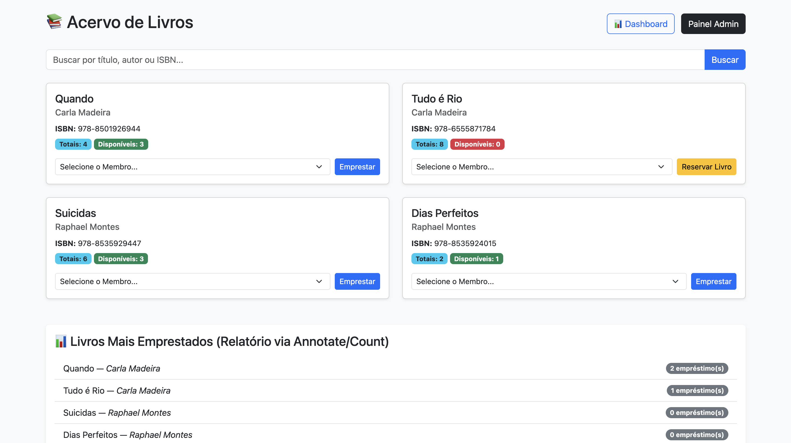
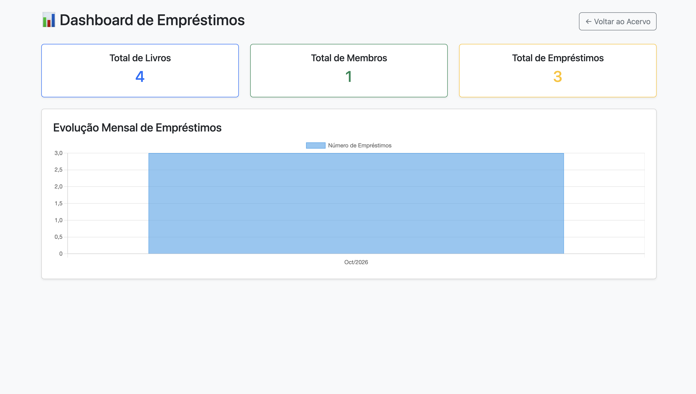
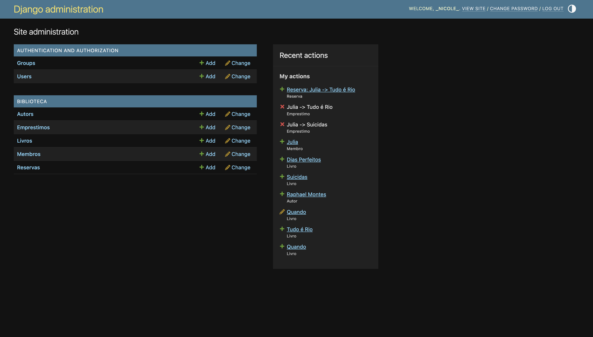

# 📚 Library Management System — Django


> **Academic Project** — A full-stack web application built with **Django** for library collection management, strict loan tracking, reservation waitlists, dynamic overdue fine calculations, ORM-driven analytics, and automated email notifications.

---

## 🛠️ 1. Step-by-Step Development Process

The application architecture follows the standard Django **MVT (Model-View-Template)** pattern within the modular `biblioteca_roma` project structure:

### **Phase 1: Project Setup & Relational Data Modeling**
1. **Environment Setup**: Configured virtual environment (`venv`), initialized the main Django project (`biblioteca_roma`), and created the core app (`biblioteca`).
2. **Database Models (`models.py`)**:
   - `Autor` (Author): Author registry.
   - `Livro` (Book): Catalog mapping total copies (`copias_totais`) and available stock on shelves (`copias_disponiveis`).
   - `Membro` (Member): Registered readers and library members.
   - `Emprestimo` (Loan): Links members and books with issue/due dates, statuses (`ATIVO`, `DEVOLVIDO`, `ATRASADO`), and dynamically calculated properties (`esta_atrasado`, `valor_multa`).
   - `Reserva` (Reservation): Priority queue for books currently out of stock.

### **Phase 2: Business Logic & Django ORM Aggregations (`views.py`)**
1. **Advanced Search**: Multi-field dynamic filtering using Django `Q` objects across Title, Author, or ISBN.
2. **Stock Tracking & Loan Limit Enforcement**:
   - Prevents loan checkout if a member already has **3 active loans**.
   - Automatically decrements available copies upon loan checkout and increments stock upon book return.
3. **Waitlist Reservation & Email Notifications**:
   - Displays a "Reserve Book" button when `copias_disponiveis == 0`.
   - Triggers automated emails via `send_mail` when a returned book becomes available for the next member in line.
4. **Analytics & Reports**:
   - Most borrowed books ranking compiled via `.annotate(total_emprestimos=Count('emprestimo'))`.
   - Monthly time-series data aggregation using `TruncMonth` to feed interactive **Chart.js** charts.

### **Phase 3: User Interface & Administration (`templates/` & `admin.py`)**
1. **Customized Django Admin**: Configured `TabularInline` views for inline loan management directly within Member profile pages.
2. **Responsive UI**: Responsive templates built with Bootstrap 5, featuring status badges, alert messages, and modal reservation views.

---

## 🚧 2. Technical Challenges & Applied Solutions

During development and refactoring, several technical challenges emerged and were resolved through architectural decisions:

| Technical Challenge | Root Cause | Implemented Solution |
| :--- | :--- | :--- |
| **Dynamic Fine Calculation** | Storing fine amounts directly in the database creates data inconsistency if returns occur at later dates. | Implemented a `@property` method on the `Emprestimo` model, dynamically calculating `(current_date - due_date) * daily_rate` only for overdue items. |
| **Database Aggregation for Charts** | Grouping loan data by month natively in SQLite for consumption by frontend libraries like Chart.js. | Leveraged Django ORM expressions (`TruncMonth` + `Count('id')`) to format labels and datasets directly into Chart.js-compatible structures. |
| **Queue Notification Logic** | Ensuring only the first waiting member in line is notified when a book copy is returned. | Queried reservations ordered by `data_reserva` filtering for `atendida=False`, updating status flags and triggering `send_mail` within the return view transaction. |
| **Git Repository Configuration** | `.gitignore` was mistakenly created as a directory, causing local SQLite databases and virtualenv files to be tracked initially. | Removed the folder via terminal (`rm -rf .gitignore`), re-created it as a proper file at the project root (`touch .gitignore`), and configured rules to ignore `venv/` and `db.sqlite3`. |

---

## 📱 3. Application Workflows & Interface Screenshots

Below is the step-by-step application flow alongside corresponding interface screenshots:

### **1. Book Catalog & Real-Time Search (`lista_livros.html`)**
> *Real-time search by title, author name, or ISBN, displaying stock availability and popular titles ranking.*



- **Workflow**: The search bar evaluates `Q(titulo__icontains=q) | Q(autor__nome__icontains=q) | Q(isbn__icontains=q)`. When available copies reach 0, the "Emprestar" (Checkout) action automatically switches to "Reservar Livro" (Reserve).

---

### **2. Loan Limit Validation & Reader History (`meus_emprestimos.html`)**
> *Loan checkout interface enforcing a maximum threshold of 3 active loans per member.*


- **Workflow**: If a member attempts to check out a 4th book, Django displays a flash error message (`messages.error`). The loan history view presents visual badges (`Active`, `Returned`, or `Overdue`) and displays accrued late fines automatically via model properties.

---

### **3. Analytics Dashboard with Chart.js (`dashboard.html`)**
> *Administrative dashboard displaying metric cards and monthly loan trend charts.*



- **Workflow**: Powered by Chart.js consuming ORM monthly aggregated queries (`TruncMonth`), giving administrators a visual overview of library activity over time.

---

### **4. Custom Django Admin Interface (`admin.py`)**
> *Tailored admin panel featuring embedded loan records inside member detail pages.*



- **Workflow**: Using `EmprestimoInline`, administrators can view and manage borrowing records directly within the member editing interface without switching pages.

---

## 🔧 Local Setup & Installation

```bash
# 1. Clone the repository
git clone https://github.com/penzonicole/django-library-system.git
cd django-library-system

# 2. Create and activate virtual environment
python3 -m venv venv
source venv/bin/activate  # macOS/Linux
# venv\Scripts\activate   # Windows

# 3. Install dependencies
pip install -r requirements.txt

# 4. Apply database migrations
python manage.py migrate

# 5. Create superuser (for Admin panel access)
python manage.py createsuperuser

# 6. Start development server
python manage.py runserver 8001